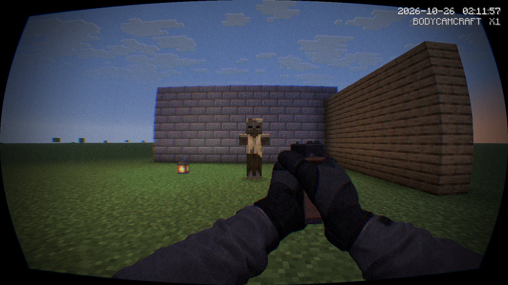
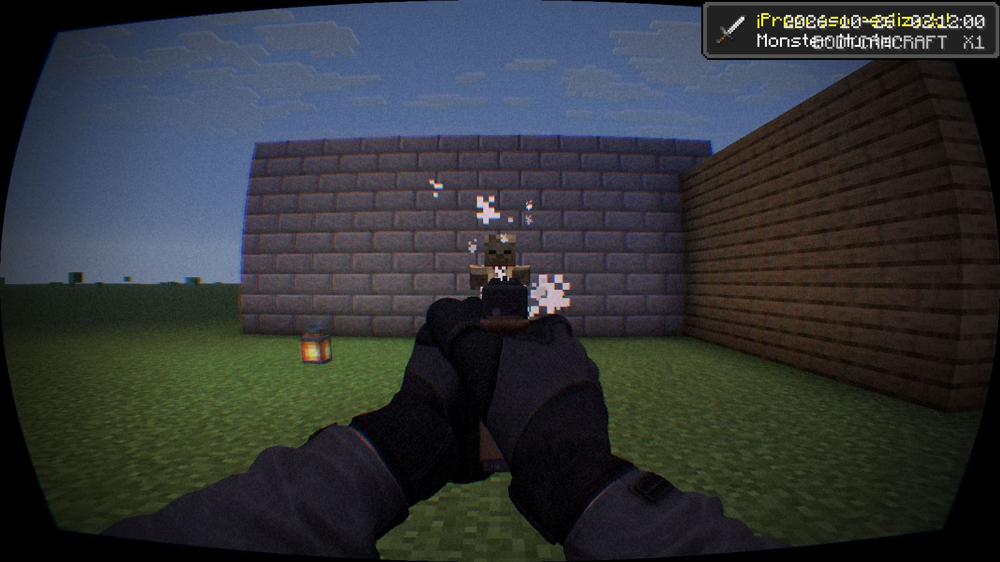
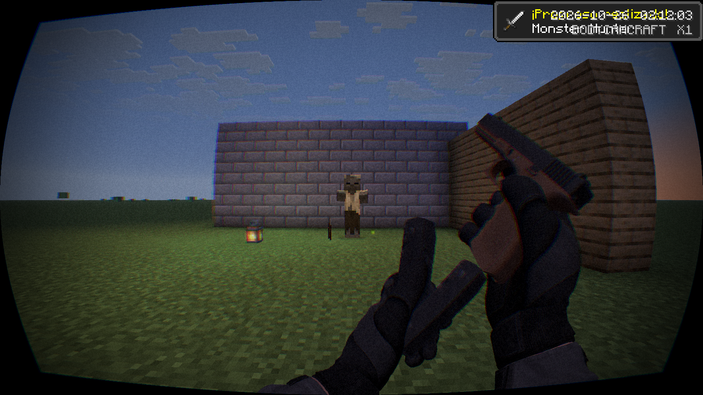
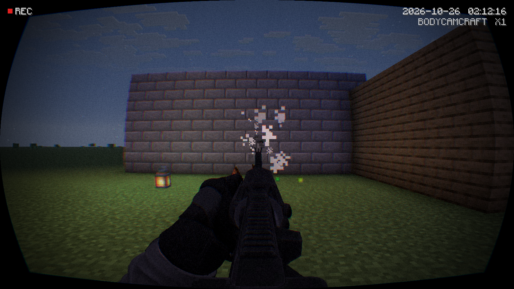

# BodycamCraft

**Minecraft survival jugado como una grabación de bodycam, con las armas, los brazos, las animaciones y los sonidos reales de tu propia copia de [Bodycam](https://store.steampowered.com/app/2406770/Bodycam/).**

*Minecraft survival played as bodycam footage, with the real guns, arms, animations and sounds from your own copy of Bodycam. [English below](#english).*

[](https://github.com/rehan-remade/universal-modder)
[](LICENSE)
[](https://melty.gg/m/bodycamcraft)



**[Ver el vídeo de demostración (33 s)](media/bodycamcraft_demo.mp4)** · [Cambios por versión](CHANGELOG.md)

## De qué va

Apareces en un mundo normal de supervivencia de Minecraft con la Glock 17 y el M4A1 de Bodycam y cargadores para los dos. Todo el juego se ve como una cámara corporal.

- **Las armas de verdad.** La Glock 17 (semiautomática, 17 balas) y el M4A1 (automático, 30 balas): sus modelos, texturas, disparos, sonidos de recarga y tamaño de cargador se leen de tu copia de Bodycam mientras juegas. El mod no incluye ningún archivo de Bodycam.
- **Cámara en el pecho.** Lente de ojo de pez con esquinas oscuras, grano, balanceo al andar y marca de grabación. No hay mira en pantalla; la barra de objetos y los corazones solo aparecen un momento al cambiar de objeto o recibir daño.
- **Los brazos y las animaciones de Bodycam.** Ves tus brazos con guantes sujetando el arma, y se mueven con las animaciones de Bodycam: reposo, apuntar, sacar el arma, el retroceso de cada disparo y todas las variantes de recarga, cada una con su sonido. El arma también se anima: el cargador sale, la mano izquierda mete el nuevo y la corredera se queda atrás con el último disparo.
- **Manejo de arma al estilo Bodycam.** El arma se mueve libremente dentro de un pequeño margen antes de que gire la cámara y las balas van adonde apunta el arma (no al centro de la pantalla).
- **Minecraft sigue siendo Minecraft.** El mundo, los mobs, construir y fabricar no cambian.

| Apuntando | Recargando | M4A1 |
|---|---|---|
|  |  |  |

## Qué necesitas

- **Minecraft: Java Edition** (cuenta de Microsoft que lo tenga).
- **Bodycam instalado en Steam.** Sin Bodycam el juego te avisa en pantalla y el arma no está disponible.
- Windows (los archivos de Bodycam se leen con tres pequeños descodificadores nativos para Windows).

## Cómo se instala

**La forma fácil: [Melty](https://melty.gg/m/bodycamcraft).** Pulsa Play. La primera vez se abre Prism Launcher para que inicies sesión con tu cuenta de Microsoft; después descarga Minecraft y Java solo (unos minutos) y arranca el juego.

**A mano**, en tu propio launcher:

1. Crea una instalación de Minecraft **1.21.11** con **Fabric Loader 0.19.5** o posterior.
2. Pon en la carpeta `mods` el archivo `bodycamcraft-<versión>.jar` (en [Releases](../../releases)) y [Fabric API](https://modrinth.com/mod/fabric-api) para 1.21.11.
3. Arranca el juego.

## Cómo se usa

Crea un mundo de un jugador en Supervivencia. Empiezas con la Glock y el M4A1 cargados y cargadores de repuesto para los dos.

| Control | Qué hace |
|---|---|
| Clic izquierdo | Disparar |
| Clic derecho (mantener) | Apuntar por las miras |
| R | Recargar (gasta un cargador) |
| V | Activar o desactivar la vista de bodycam |

- **Más cargadores (sin forma, en cualquier mesa de trabajo):** Glock: lingote de hierro + lingote de cobre + pólvora. M4A1: 2 lingotes de hierro + lingote de cobre + pólvora.
- **Fabricar un M4A1:** bloque de hierro + 2 lingotes de hierro + lingote de cobre + palo.
- **Puertas y cofres:** el clic derecho sigue abriéndolos aunque lleves el arma.
- **Sin mira:** apunta con el arma. Dos tiros al cuerpo tumban a un zombi; a la cabeza hace más daño.
- Las teclas se pueden cambiar en Opciones → Controles → BodycamCraft.

## Desinstalar

- **Melty:** desinstálalo desde la app; borra su carpeta con el launcher y la instancia.
- **A mano:** quita `bodycamcraft-<versión>.jar` de la carpeta `mods`.

El mod no cambia nada de Bodycam ni de tu instalación normal de Minecraft: usa una instancia aparte. Tus mundos de BodycamCraft están en la carpeta `saves` de esa instancia; cópialos antes de desinstalar si quieres conservarlos.

## Si algo falla

| Qué ves | Causa | Qué hacer |
|---|---|---|
| Melty dice que no hay espacio en disco | Hacen falta unos 2 GB libres para el launcher, Minecraft y Java | Libera espacio en el disco donde instala Melty y vuelve a pulsar Play |
| La descarga se corta ("fetch failed") | Conexión interrumpida | Vuelve a pulsar Play |
| Se abre Prism Launcher y pide iniciar sesión | Es la primera vez; Minecraft necesita tu cuenta de Microsoft | Inicia sesión con la cuenta que tiene Minecraft: Java Edition. Solo se pide una vez |
| Aviso en pantalla de que no se encuentra Bodycam | Bodycam no está instalado en Steam en este PC | Instala Bodycam desde Steam y reinicia el juego |
| El arma no aparece o no suena | Bodycam se actualizó y cambió sus archivos | Abre una incidencia con el registro |

El registro está en `Prism/instances/BodycamCraft/.minecraft/logs/latest.log`, dentro de la carpeta donde Melty instaló el mod (o en `.minecraft/logs/latest.log` de tu launcher). Si el mod arrancó, contiene la línea `BodycamCraft loaded`. Para avisar de un fallo: [Issues](../../issues).

## Compatibilidad

- **Versiones probadas:** Minecraft 1.21.11, Fabric Loader 0.19.5, Fabric API 0.141.6, Bodycam de Steam (build 25505592). Solo Windows.
- **Multijugador:** no probado; está pensado para un jugador.
- **Otros mods:** no probado con shaders (Iris) ni con mods que cambien la cámara o la mano en primera persona; pueden chocar con la vista de bodycam.
- **Bodycam:** el mod solo lee sus archivos. No lo abre, no lo modifica y no toca su multijugador ni su anti-cheat.

## Estado y límites

Un solo jugador y dos armas (Glock 17 y M4A1).

- La animación de sacar el arma dura lo mismo que en Bodycam (unos 2 s), pero puedes disparar antes y se corta.
- Los brazos se deforman en el procesador en cada fotograma; en equipos lentos puede notarse.
- El daño, la dispersión y el retroceso están ajustados para los mobs de Minecraft; el tamaño del cargador sí es el de Bodycam.
- Probado con una prueba automática dentro del juego (equipo inicial, disparo, impacto, recarga). El apuntado libre con ratón y los sonidos aún necesitan más pruebas a mano.

## Cómo está hecho

```
Tu copia de Bodycam (Steam)                    Minecraft 1.21.11 + Fabric
  Content/Paks/*.pak  ── solo lectura ──>        gg.bodycamcraft.bodycam   lee el índice de los .pak
    mallas y sockets del arma                      bcoodle.dll             descomprime (Oodle)
    texturas virtuales (DXT)                       bcbinka.dll             descodifica el audio (Bink)
    sonidos (Bink Audio)                           bcacl.dll               descomprime las animaciones (ACL)
    brazos, esqueleto y animaciones              ArmsRenderer              pone los brazos en postura y los dibuja
    tabla de cargadores (DT_MAG)                 GunRenderer, BodycamSounds  dibuja y hace sonar el arma
                                                 GunLogic (servidor)       disparo, impacto, recarga
                                                 BodycamView + bodycam.fsh lente, grano, balanceo
```

Nada de Bodycam se copia al disco ni al paquete: los datos se leen al arrancar el juego y se quedan en memoria.

- `mod/`: el mod de Fabric (Java). `mod/src/main/java/gg/bodycamcraft/bodycam/` lee los archivos `.pak` de Bodycam: mallas, texturas, sonidos y la tabla de cargadores.
- `design/sheets/`: hojas JSON con todo el diseño (armas, piezas, sonidos, cámara, objetos, enganches con Minecraft). Son la fuente de verdad; `python design/sheets.py gen` las comprueba y genera código y recursos a partir de ellas.
- `native/`: el código de los tres descodificadores (`bcoodle`, `bcbinka`, `bcacl`).
- `package.py`: empaqueta una versión (el `.jar` y un Prism Launcher portátil con la instancia lista).
- `melty.json`: la receta de instalación para Melty.

Para compilar: JDK 25 para Gradle (`cd mod && gradlew build`). Prueba dentro del juego: `gradlew runClient -Pautotest`.

## Hacer un remix

El código es MIT: puedes cambiarlo y publicar tu versión. [AGENTS.md](AGENTS.md) explica dónde está cada cosa y cómo añadir un arma (sirve igual para una persona que para un agente de IA), y [CONTRIBUTING.md](CONTRIBUTING.md) las reglas para proponer cambios aquí. En cada cambio, GitHub comprueba solo que las hojas de diseño cuadran, que no se ha colado ningún archivo de juego ni clave, y que el mod compila.

## Reglas que sigue

- **No incluye archivos de ningún juego.** Ni de Bodycam ni de Minecraft, ni código descompilado.
- **Necesitas tener los dos juegos.** No se salta ninguna comprobación de compra ni de cuenta.
- **No toca el multijugador ni el anti-cheat de Bodycam.**
- **No se inventa contenido.** Lo que no se puede leer de Bodycam no se sustituye por una imitación.

## Créditos y licencia

Código de BodycamCraft bajo licencia [MIT](LICENSE). Puedes hacer remixes. Autor: issac_leral.

- **Hecho con IA:** el código lo escribió Claude Code (Opus 5.5) dirigido por issac_leral. No hay arte ni sonido generado por IA: todo lo que se ve y se oye del arma sale de tu copia de Bodycam.

- [oozextract](https://github.com/lvlvllvlvllvlvl/oozextract) (MIT): descompresión de los archivos de Bodycam.
- [vgmstream](https://github.com/vgmstream/vgmstream) (ISC): descodificador de Bink Audio.
- [ACL](https://github.com/nfrechette/acl) y [RTM](https://github.com/nfrechette/rtm) (MIT): descompresión de las animaciones de Bodycam.
- [Fabric](https://fabricmc.net/) y [Prism Launcher](https://prismlauncher.org/) (GPL-3.0), incluidos en el paquete de Melty.
- El kit [universal-modder](https://github.com/rehan-remade/universal-modder): su forma de trabajar, sus reglas y su comprobación previa a publicar.

Bodycam es de Reissad Studio y Minecraft es de Mojang/Microsoft. Este proyecto no está afiliado a ninguno de ellos y no distribuye contenido de ninguno de los dos juegos.

---

## English

BodycamCraft drops you into a normal Minecraft survival world holding Bodycam's Glock 17 and M4A1, and shows the whole game as bodycam footage.

- **The real guns.** The Glock 17 (semi-auto, 17 rounds) and the M4A1 (full auto, 30 rounds): models, textures, gunshots, reload sounds and magazine sizes are read from your own copy of Bodycam while the game runs. The mod ships nothing of Bodycam's.
- **Chest camera.** Fisheye lens with dark corners, grain, sway and a recording stamp. No crosshair; the hotbar and hearts only peek in after a slot change or a hit.
- **Bodycam's arms and animations.** Your gloved arms hold the gun and move with Bodycam's own animations: idle, aiming, drawing, the recoil of each shot and every reload variant, each with its sound. The gun animates too: the magazine comes out, the left hand brings the fresh one in, the slide locks back on the last round.
- **Bodycam-style handling.** The gun aims freely inside a small box before the camera turns, and shots go where the gun points.

**You need** Minecraft: Java Edition, Bodycam installed on Steam, and Windows.

**Install:** press Play on [Melty](https://melty.gg/m/bodycamcraft), or put the jar from [Releases](../../releases) and Fabric API into the `mods` folder of a Minecraft 1.21.11 + Fabric Loader install.

**Controls:** left click fires, hold right click to aim, **R** reloads, **V** toggles the bodycam view. Craft magazines from an iron ingot, a copper ingot and gunpowder.

**Limits:** single player, two guns; the damage numbers are this mod's own. Bodycam's arms and animations (draw, recoil, every reload) are used as they are.

**Trouble?** Melty needs about 2 GB free. The log is `Prism/instances/BodycamCraft/.minecraft/logs/latest.log` in the folder Melty installed to. Report problems in [Issues](../../issues).

**Remix it:** see [AGENTS.md](AGENTS.md), [CONTRIBUTING.md](CONTRIBUTING.md) and the [changelog](CHANGELOG.md). Code written by Claude Code (Opus 5.5) directed by issac_leral; no AI-generated art or sound.

MIT licensed. Not affiliated with Reissad Studio, Mojang or Microsoft.
